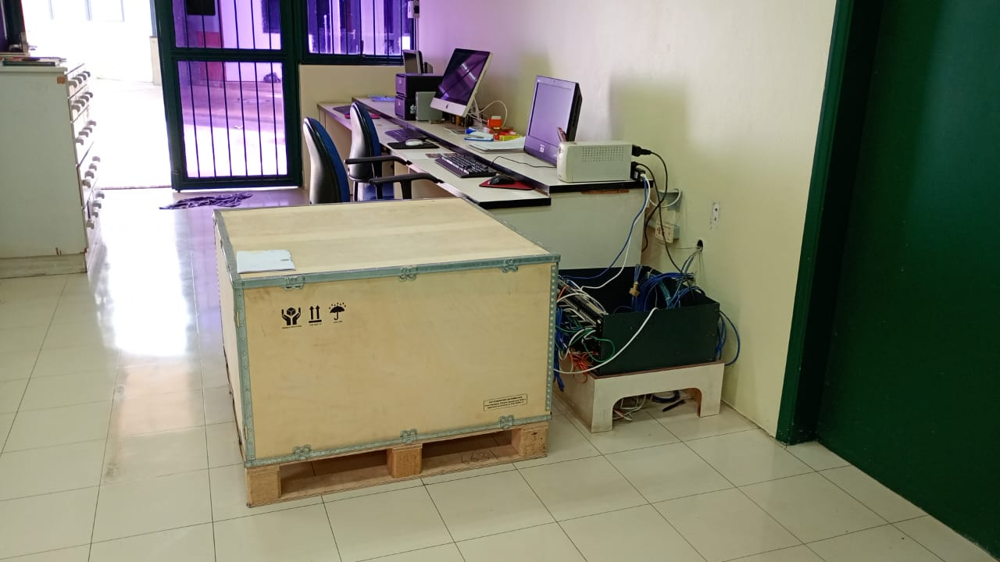
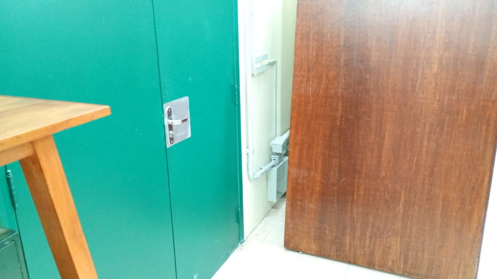

# Termo de Referência / Memorial Descritivo

---
title: Relocação de rack de piso, reinstalação de cabeamento Cat 5e e fornecimento de rack fechado
---

**Órgão/Entidade:** Laboratório de Imagem e Som em Antropologia (LISA) – Departamento de Antropologia – FFLCH/USP  
**CNPJ da FFLCH:** 63.025.530/0016-90  
**Endereço do Serviço:** Rua do Anfiteatro, 181, Cidade Universitária, São Paulo/SP, Brasil  
**Objeto:** Contratação de empresa especializada para o realocação de rack de rede
**Escopo do fornecimento:** Prestação de serviço com fornecimento do rack de piso e acessórios, mão de obra especializada, ferramentas e equipamento de certificação.  
**Agendamento para vistoria:** Leonardo Rovina Fuzer <leofuzer@usp.br>

---

## 1. Objetivo do serviço

1.1. O presente documento estabelece as especificações técnicas, exigências operacionais e diretrizes para a contratação de empresa especializada na execução dos serviços de **relocação de rack de rede** do Laboratório de Imagem e Som em Antropologia (LISA/USP) para o cômodo adjacente (diametralmente oposto, do outro lado da parede).

1.2. **Caracterização da intervenção:**
- **Reaproveitamento de cabos:** Serão mantidos os **22 (vinte e dois) cabos de rede UTP Categoria 5e (Cat 5e)** existentes no local.
- **Procedimento operacional:** A contratada deverá cortar a terminação traseira dos 22 cabos no *patch panel* atual, recolocar  o feixe de cabos atravessando a parede para o cômodo oposto.
- **Abertura na parede:** A perfuração/passagem na parede **já se encontra pronta e executada** (*parede já furada*).
- **Montagem do rack:** Montagem, posicionamento e fixação do novo **Rack de Piso Fechado (24U)** fornecido pela empresa contratada no novo cômodo.
- **Reconectorização:** Crimpagem/punch-down dos 22 cabos Cat 5e no *patch panel* do novo rack, organização do cabeamento interno, identificação e certificação técnica dos 22 pontos.

### 1.3. Registro Fotográfico do Local

<table style="width: 100%; border-collapse: collapse; border: none; margin: 20px 0;">
  <tr>
    <td style="width: 50%; padding: 6px; border: none; text-align: center; vertical-align: top;">
      
       <strong>Foto 1:</strong> Legenda: Rack atual com os 22 cabos Cat 5e que serão cortados e migrados
    </td>
    <td style="width: 50%; padding: 6px; border: none; text-align: center; vertical-align: top;">
      
       <strong>Foto 2:</strong> Legenda: Parede perfurada por onde os cabos serão transpostos para o novo rack de piso.
    </td>
  </tr>
</table>

---

1.4. **Restrição absoluta de escopo e infraestrutura:**
- **Não há serviços de infraestrutura civil ou de caminhamento:** Não serão instaladas novas canaletas, eletrodutos, eletrocalhas, perfilados ou caixas de passagem.
- O serviço limita-se estritamente ao fornecimento do rack, manobra de corte/passagem dos 22 cabos pelo furo existente na parede, reconectorização no *patch panel*, organização interna no rack e testes de certificação.

---

## 2. Especificação técnica do rack a ser fornecido (Contratada)

A contratada deverá fornecer e instalar no local **01 (um) Rack de Piso Fechado de 24U**, novo e de primeiro uso, fixo no chão, atendendo rigorosamente às seguintes especificações técnicas:

* **Altura Útil:** 24U (altura externa aproximada de 1,15 m a 1,25 m com pés niveladores).
* **Largura Externa:** 600 mm (padrão 19" interno).
* **Profundidade Externa:** 800 mm (garante ventilação traseira adequada para fontes e cabos sem esmagamento).
* **Padrão de Montagem:** 19 polegadas com planos de fixação (trilhos frontais e traseiros) perfurados em padrão "Gaiola de Porca" e com regulagem de profundidade.
* **Porta Frontal:** Armação em aço com visor em vidro temperado de 4 mm e fechadura com chave.
* **Portas Laterais e Traseira:** Painéis em chapa de aço tratado, removíveis por fecho rápido, com fechadura.
* **Sistema de Ventilação:** Teto perfurado equipado com kit de ventilação forçada contendo no mínimo 2 (duas) ventoinhas/coolers de teto (110V/220V).
* **Entrada de Cabos:** Passagens destacáveis com proteção/escova na base inferior e no teto superior para manobra de cabeamento.
* **Base e Fixação:** Estrutura preparada para fixação direta no chão, sem rodízios/rodas, equipada com 04 (quatro) pés niveladores rosqueáveis e de alta resistência para alinhamento, estabilização mecânica e ancoragem no piso.

* **Acessórios Mínimos Inclusos no Rack:**
  * 01 (uma) Régua de Tomadas PDU 19" (no mínimo 8 tomadas padrão NBR 14136 com disjuntor/proteção de surto);
  * 02 (dois) Organizadores de cabos horizontais de 1U com tampa (19");
  * 01 (uma) Bandeja fixa de 1U para suporte de equipamentos;
  * Kit de porcas-gaiola e parafusos para fixação dos equipamentos.

* **Aterramento:** Barramento dedicado para aterramento de carcaça.

---

## 3. Escopo dos serviços e divisão de responsabilidades

### 3.1. Atribuições e obrigações da contratada
1. **Fornecimento e montagem do rack:** Entrega, desembalagem, posicionamento, nivelamento e preparação do rack de piso 24U especificado no Item 2 no novo cômodo.
2. **Corte e transposição dos cabos:**
   * Desconexão e corte cuidadoso das pontas dos 22 cabos Cat 5e junto ao *patch panel* antigo.
   * Passagem do feixe de 22 cabos através da perfuração existente na parede (conforme **Foto 2**).
   * Acomodação e organização dos cabos na entrada do novo rack de piso, garantindo raio mínimo de curvatura para não danificar o cabeamento existente.
3. **Reconectorização:**
   * Crimpagem / punch-down dos 22 cabos no *patch panel* (padrão T568A ou T568B, mantendo a pinagem original da instalação existente).
   * Organização dos *patch cords* e cabos internos utilizando os organizadores horizontais e braçadeiras adequadas.
4. **Identificação e etiquetagem:**
   * Etiquetagem bidirecional e clara de cada uma das 22 portas no *patch panel* e na traseira dos cabos, correspondendo às posições das tomadas na ponta do usuário.
5. **Certificação técnica:**
   * Realização de ensaios de campo/certificação técnica em **100% dos 22 pontos de rede (Cat 5e)**, utilizando equipamento certificador homologado (ex.: Fluke DSX Series ou equivalente) com certificado de calibração válido.
6. **Limpeza e recolhimento:**
   * Recolhimento de sobras de materiais, retalhos de cabos, embalagens e limpeza da área de trabalho ao final do serviço.

### 3.2. Divisão do fornecimento de materiais e insumos

> **Fornecimento integral pela CONTRATADA:**  
> * 01 Rack de Piso Fechado 24U (600x800mm) completo com PDU, kit de ventilação, organizadores e bandeja;
> * *Patch panel* Cat 5e de 24 portas;
> * Equipamento certificador de rede calibrado e ferramentas de punch-down/crimpagem;
> * Insumos de organização e identificação (braçadeiras de nylon/velcro e etiquetas industriais).

> **Fornecimento/Existente na CONTRATANTE (LISA – FFLCH/USP):**  
> * Infraestrutura de cabo rígido (os 22 lançamentos de cabo Cat 5e que permanecem na edificação);
> * Infraestrutura física de passagem (furo na parede já realizado e vias existentes);
> * Pontas remotas dos usuários (caixas, espelhos e conectores fêmea RJ-45 mantidos nas salas).

---

## 4. Segurança e saúde no trabalho (SST)

- A contratada assume integral e exclusiva responsabilidade pela gestão civil, trabalhista e previdenciária referente à segurança de seus colaboradores.
- Os técnicos deverão utilizar Equipamentos de Proteção Individual (EPIs) adequados para o manuseio de ferramentas, corte de cabos e movimentação de equipamentos pesados (rack de piso).
- Procedimentos preventivos de segurança em eletricidade em atendimento à norma **NR-10**.

---

## 5. Certificação da rede e critérios de aceite (entregáveis)

O aceite definitivo e a liberação de pagamento ficam condicionados ao atendimento de 100% dos seguintes itens:

1. **Montagem e instalação do Rack:** Verificação física da perfeita instalação e funcionamento dos acessórios do Rack 24U (estabilidade, ventoinhas, PDU energizada e organização).
2. **Conectorização e integridade:** Todos os 22 pontos Cat 5e devidamente conectorizados, organizados e identificados.
3. **Parâmetros de teste (pass):** Apresentação de relatório de certificação indicando status **APROVADO (PASS)** para todos os 22 pontos de rede Cat 5e, contemplando:
   * Mapa de fiação (*wiremap*);
   * Comprimento;
   * Atenuação / Perda de inserção;
   * Diafonia (*NEXT*);
   * Perda de retorno (*return loss*).
4. **Relatório técnico:** Entrega do relatório emitido pelo equipamento de certificação em formato digital (PDF e arquivo nativo do equipamento).

---

## 6. Normas técnicas de referência

- **ABNT NBR 14565:** Cabeamento estruturado para edifícios comerciais;
- **ABNT NBR 16264:** Cabeamento estruturado – Ensaios no campo;
- **NR-10 (MTE):** Segurança em instalações e serviços em eletricidade.